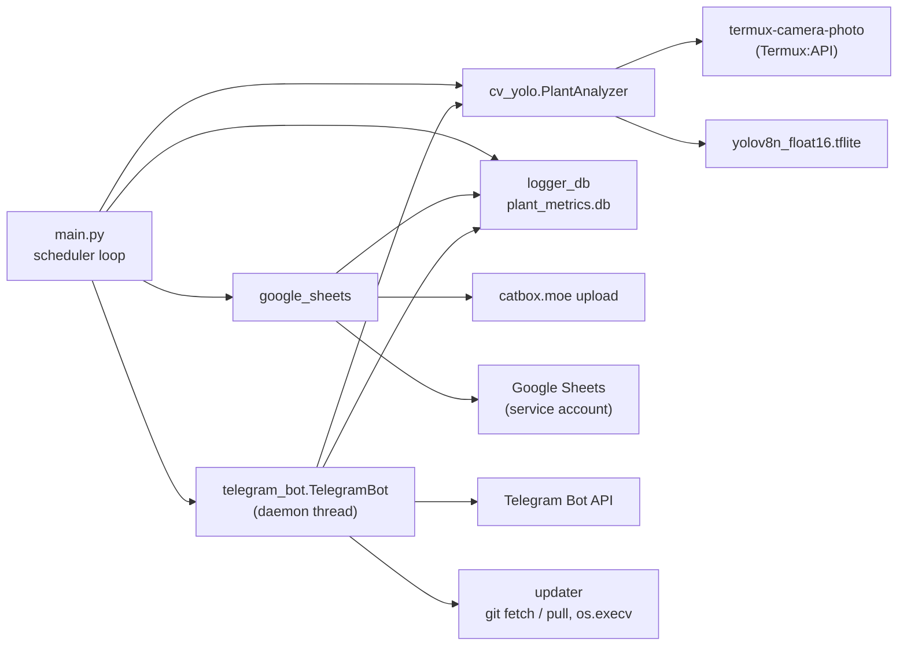

# CameraHome: documentation

CameraHome is a set of Python scripts that run on an Android phone under Termux and use the phone camera through Termux:API. It has two entry points. `main.py` is a plant growth monitor: it takes a photo on a schedule, measures the share of green pixels, counts YOLO detections, stores the result in SQLite, copies it to Google Sheets and reports to a Telegram bot. `vision_mqtt.py` is an older person-detection loop that sends alerts to Telegram and to an MQTT broker. The code does not say who the users are beyond the owner of one bot and one spreadsheet (see [SPEC.md](../SPEC.md), open questions).

The requirements specification is in [../SPEC.md](../SPEC.md).

## Status

- Last commit touching the project's code: `3c3d993`, 2026-07-12 (`google_sheets.py` only: photo hosting moved to Catbox). The last commit overall is `f6f2902`, 2026-08-05, which adds `LICENSE`. Source: `git log`.
- History: the person detector (`vision_mqtt.py`) was written on 2026-04-05; the plant monitor (`config.py`, `cv_yolo.py`, `google_sheets.py`, `logger_db.py`, `main.py`, `telegram_bot.py`, `updater.py`) was added on 2026-07-12 in commit `e754b58`.
- Tests: none. CI: none. Dependency manifest (`requirements.txt`, `pyproject.toml`): none. Dependencies are listed only in the install commands in `README.md:50-61`.
- Unfinished, as the code itself shows:
  - temperature and humidity are always stored as empty, with the comment "In future, read from MQTT" (`main.py:43-44`);
  - `MQTT_HOST`, `MQTT_PORT`, `MQTT_TOPIC` are read under the comment "MQTT (For future expansion)" (`config.py:32-35`), and nothing in the plant monitor uses them;
  - `/status` does not report the last measured metrics that `README.md:21` promises (`telegram_bot.py:90-101`).

## Layout

| Path | Contents |
|---|---|
| `main.py` | Plant monitor entry point: scheduler loop and the measurement pipeline |
| `config.py` | Reads `.env` into the environment and exposes the settings as module constants |
| `cv_yolo.py` | `PlantAnalyzer`: camera capture via `termux-camera-photo`, HSV green mask and contours, YOLO TFLite detection, annotation |
| `logger_db.py` | SQLite cache `plant_metrics.db`, table `metrics` with a `sync_status` column |
| `google_sheets.py` | Photo upload to catbox.moe (function `upload_to_drive`) and the SQLite-to-Google-Sheets sync |
| `telegram_bot.py` | `TelegramBot`: long-polling thread and the command handlers |
| `updater.py` | `git fetch` / `git pull` and in-place process restart for `/update` |
| `vision_mqtt.py` | Separate entry point: person detection with Telegram and MQTT alerts |
| `yolov8n_float16.tflite` | TFLite model file (6 476 236 bytes) loaded by default by both entry points |
| `.env.example` | Configuration template |
| `README.md` | Setup guide for Termux, Google Cloud and Telegram |
| `telegram_screenshot.png`, `sheets_screenshot.png` | Screenshots shown in `README.md:4-5` |
| `image.png`, `image-1.png` | Images used by an earlier README (commit `ecd8b02`); the current README does not reference them |
| `LICENSE` | MIT licence |

## Architecture



One measurement (`main.py:18-69`):

1. `capture_photo` runs `termux-camera-photo -c <CAMERA_ID> snap.jpg` with a 15 s timeout (`cv_yolo.py:27-40`).
2. `analyze_image` computes the green-pixel percentage in HSV, draws the green contours, runs YOLO for COCO class 58 ("potted plant", per the comment at `cv_yolo.py:90`) and overwrites `snap.jpg` with the annotated image (`cv_yolo.py:42-140`).
3. The annotated image is shrunk to at most 1024 px and uploaded to catbox.moe. The returned URL is kept (`google_sheets.py:23-58`).
4. A row goes into SQLite with status `pending` (`logger_db.py:29-40`).
5. The annotated photo and a caption go to Telegram (`main.py:56-58`).
6. All `pending` rows are appended to the first worksheet of the spreadsheet and marked `synced` (`google_sheets.py:60-106`).

The Telegram bot runs in a daemon thread started by `main.py:95` (`telegram_bot.py:172-177`). Its commands change `config.SIMULATION` and `config.INTERVAL_HOURS` in memory, and the main loop reads them (`main.py:106-109`).

`vision_mqtt.py` shares no code with the modules above. It has its own `.env` loader, Telegram notifier and capture code (`vision_mqtt.py:12-21`, `:31-80`, `:111-184`).

External systems: Termux:API camera, Telegram Bot API, Google Sheets API (gspread with a service account), catbox.moe, git remote (for `/update`), and an MQTT broker (`vision_mqtt.py` only).

## Build and run

Prerequisites, from `README.md:29-42`: Android with Termux and Termux:API from F-Droid, with the camera permission granted to Termux:API; a Google Cloud project with the Sheets and Drive APIs enabled; a service account key saved as `credentials.json`; a spreadsheet shared with that service account as Editor. No versions are pinned anywhere in the repository.

Install inside Termux (`README.md:51-54`, `README.md:60`):

```bash
pkg update && pkg upgrade -y
pkg install x11-repo -y
pkg update
pkg install termux-api python python-cryptography python-numpy python-pillow opencv-python git dbus -y
pip install gspread google-auth requests tflite-runtime
```

Clone and configure (`README.md:66-73`):

```bash
git clone -b plant-growth-metrics-termux https://github.com/IGORSVOLOHOVS/CameraHome.git
cd CameraHome
cp .env.example .env
nano .env
```

The branch `plant-growth-metrics-termux` named in `README.md:66` does not exist in this clone: `git branch -a` lists only `main`, and the fetch refspec covers all heads. The plant monitor code is on `main`.

Run the plant monitor from the repository root (`README.md:87`):

```bash
python main.py
```

Run the person detector: `vision_mqtt.py` takes the flags defined at `vision_mqtt.py:224-231` (table below). The current README does not describe it. It imports `paho.mqtt.client` (`vision_mqtt.py:7`), and `paho-mqtt` is not in the `pip install` line of `README.md:60`.

All file paths in the code are relative (`.env`, `credentials.json`, the model, `snap.jpg`, `plant_metrics.db`), so both scripts must be started from the repository root (`config.py:3`, `logger_db.py:4`, `cv_yolo.py:27`).

## Configuration

Environment variables, read from `.env` by `config.py:3-14` (plant monitor) or `vision_mqtt.py:12-21` (person detector). Values from `.env` overwrite variables already set in the process environment (`config.py:11`, `vision_mqtt.py:19`).

| Variable | Used by | Default in code | In `.env.example` | Meaning |
|---|---|---|---|---|
| `TELEGRAM_TOKEN` | both | none; `main.py` exits with code 1 without it (`main.py:85-87`) | placeholder | Bot token |
| `TELEGRAM_CHAT_ID` | both | none | placeholder `your_telegram_chat_id` | Chat that receives messages and is allowed to send commands. Auto-discovery runs only when the value is empty (`telegram_bot.py:147`) |
| `SPREADSHEET_ID` | `main.py` | none; sync is skipped (`google_sheets.py:64-66`) | placeholder | Target spreadsheet |
| `CREDENTIALS_FILE` | `main.py` | `credentials.json` (`config.py:20`) | `credentials.json` | Service account key file |
| `CAMERA_ID` | both | `0` (`config.py:23`, `vision_mqtt.py:230`) | `0` | Value passed to `termux-camera-photo -c` |
| `MODEL_PATH` | both | `yolov8n_float16.tflite` (`config.py:24`, `vision_mqtt.py:225`) | same | TFLite model file |
| `THRESHOLD` | both | `0.25` in `config.py:25`; `0.6` in `vision_mqtt.py:229` | `0.25` | Plant monitor: YOLO score and NMS threshold. Person detector: alert threshold |
| `INTERVAL_HOURS` | `main.py` | `3` (`config.py:29`) | `3` | Measurement interval outside simulation |
| `SIMULATION` | `main.py` | `False`; `true`, `1`, `yes` enable it (`config.py:30`) | `True` | Simulation mode: one measurement per 60 s (`main.py:106-107`) |
| `COOLDOWN` | `vision_mqtt.py` | `30` (`vision_mqtt.py:231`) | absent | Minimum seconds between alerts. `config.py:26` also reads it, but the plant monitor does not use it |
| `MQTT_HOST` | `vision_mqtt.py` | none; MQTT is skipped (`vision_mqtt.py:98-100`) | absent | Broker address. `config.py:33` also reads it, unused |
| `MQTT_PORT`, `MQTT_TOPIC` | none | `1883`, `home/plant/metrics` (`config.py:34-35`) | absent | Read but not used |

Files: `.env` and `credentials.json` are listed in `.gitignore:6` and `.gitignore:10`. Do not commit them.

`vision_mqtt.py` flags (`vision_mqtt.py:224-231`): `--model`, `--host`, `--token`, `--chat_id`, `--threshold`, `--camera`, `--cooldown`. Each defaults to the environment variable in the table above. The MQTT port is fixed at 1883 because `setup_net` is called without a port (`vision_mqtt.py:97`, `:237`).

## Usage

- **Periodic monitoring.** Start `python main.py`. The first measurement runs right away, because `last_measurement_time` starts at 0 (`main.py:16`, `:111`). The next ones follow every `INTERVAL_HOURS`, or every 60 s in simulation. Each one sends a photo with green percentage and detection count to Telegram and appends rows to the sheet.
- **Linking the chat.** Leave `TELEGRAM_CHAT_ID` empty, start the bot and send it any message. The bot binds to that chat and replies with a greeting (`telegram_bot.py:147-158`). The chat ID is not saved, so the same step is needed after every restart.
- **Bot commands** (`telegram_bot.py:62-142`). Commands match case-insensitively by prefix.

| Command | Effect |
|---|---|
| `/start`, `/help` | Command list |
| `/photo` | Capture, analyse and send the annotated photo. The result is not stored or synced |
| `/status` | Mode, number of unsynced rows, model file name, camera ID |
| `/interval <hours>` | Set a positive interval in hours (in memory) and trigger a measurement now. Without an argument it shows the current value |
| `/simulate` | Toggle simulation mode (in memory) and trigger a measurement now |
| `/sheets` | Link `https://docs.google.com/spreadsheets/d/<SPREADSHEET_ID>/edit?usp=sharing` |
| `/update` | `git fetch`, then `git pull` if `git status -uno` says the branch is behind, then restart the process |

- **Command autocomplete.** Register the list in `README.md:98-105` with BotFather.
- **Person detection.** Run `vision_mqtt.py` with `--token` and optionally `--host`. When a person score exceeds `--threshold` and the cooldown has passed, it publishes `{"status": "detected", "confidence": <float>}` to `home/camera/detection` and sends the annotated photo to Telegram (`vision_mqtt.py:192-219`).

## Testing

The repository has no tests and no CI configuration. While writing this document, two throwaway scripts were run in a temporary directory outside the repository (not part of the project, see "About this document"). With `cv2`, `tflite_runtime` and `gspread` stubbed and the network calls replaced, they confirmed:

- with the values from `.env.example`, `TELEGRAM_CHAT_ID` is the string `your_telegram_chat_id` and auto-discovery does not run;
- `/status` output;
- a failed capture leaves `last_measurement_time` at 0;
- the SQLite-to-Sheets sync writes the header and a `=HYPERLINK(..., IMAGE(...))` cell, rows stay `pending` when the sync fails, and a failing `git pull` raises `AttributeError` out of `updater.check_and_pull`.

Camera, YOLO inference, HSV analysis (OpenCV is not installed here) and all real network services were not exercised.

## Known limitations and problems

Found by reading the code. Items marked "checked" were reproduced offline as described under Testing.

1. **The placeholder chat ID disables the bot (checked).** `README.md:78` says `TELEGRAM_CHAT_ID` can stay `your_telegram_chat_id`. The code then treats the placeholder as a real chat ID: auto-discovery is skipped (`telegram_bot.py:147`), messages go to a chat that does not exist, and every incoming command is ignored because the chat IDs never match (`telegram_bot.py:168`). The value must be empty for auto-discovery to run.
2. **Camera failures cause a message storm (checked in part).** When capture fails, `run_measurement` returns before it updates `last_measurement_time` (`main.py:24-30`, `:68`). So the main loop retries on every iteration (1 s sleep plus up to 15 s capture timeout) and sends the warning to Telegram each time. The repeat rate is inferred from `main.py:103-114`.
3. **A failing `git pull` stops the bot (checked in part).** In the `CalledProcessError` handler, `e.stderr.decode()` is called on a `str`, because the pull runs with `text=True` (`updater.py:17`, `:22`). The resulting `AttributeError` is outside every handler. Inferred from `telegram_bot.py:144-170`: it ends the polling thread, so the bot stops answering, while measurements continue in the main thread.
4. **Update detection depends on git's language.** `/update` looks for the English strings "Your branch is behind" or "can be fast-forwarded" (`updater.py:16`). With localised git output it always answers "Already up to date."
5. **The first chat to write takes control.** With an empty chat ID, the bot binds to whoever messages it first, and that chat can then run `/update` (`telegram_bot.py:147-158`). `vision_mqtt.py` takes the chat of the last update in the same way (`vision_mqtt.py:42-48`).
6. **Shared files with no lock.** `/photo` in the bot thread and the scheduled measurement in the main thread both write `snap.jpg` (`telegram_bot.py:80-84`, `main.py:24-32`). Inference: overlapping runs can mix up files.
7. **YOLO sees the contours.** Green contours are drawn into the image before the same image is passed to YOLO (`cv_yolo.py:66-79`).
8. **"Plants/Leaves" counts potted plants.** The number is the count of COCO class 58 detections after NMS, not a leaf count (`cv_yolo.py:42`, `:90-125`). If the model has fewer than 59 classes, class 0 is used instead (`cv_yolo.py:96`).
9. **Asterisks are shown literally.** Messages contain `*...*` but are sent without `parse_mode` (`main.py:49`, `telegram_bot.py:25`). Inference: Telegram shows them as plain characters.
10. **Runtime settings are lost on restart.** `/interval` and `/simulate` change values in memory only, and a restart returns to `.env` (`telegram_bot.py:104`, `:117`).
11. **The template enables simulation.** `.env.example:16` sets `SIMULATION=True`, so a copied template measures every 60 s.
12. **Photos are public.** Annotated photos go to catbox.moe anonymously, with no account or deletion (`google_sheets.py:36-43`). The function name `upload_to_drive` and the comments at `main.py:34-36` still say Google Drive.
13. **Temperature and humidity are always empty** in SQLite and in the sheet (`main.py:43-44`).
14. **`THRESHOLD` has two meanings.** Both entry points read it with different defaults (`config.py:25`, `vision_mqtt.py:229`), and `.env.example:12` sets 0.25. If one `.env` is shared, the person alert threshold becomes 0.25.
15. **The person detector is not documented or installed.** Its dependency `paho-mqtt` is missing from the install line (`README.md:60`), and the current README does not mention the script. No paho-mqtt version is pinned, and `mqtt.Client()` with no arguments (`vision_mqtt.py:103`) raises `TypeError` in paho-mqtt 2.0.0, where `callback_api_version` is a required argument; 2.1.0 and 2.2.0 default it to version 1 with a `DeprecationWarning` (read from the published wheels, not run). The 2.0.0 error is caught and MQTT is turned off (`vision_mqtt.py:107-109`).
16. **No manifest, no tests, no CI.** Large binaries are committed: the model (6 476 236 bytes) and `image-1.png` (5 991 592 bytes). `temp_catbox_upload.jpg` is not in `.gitignore`.

## Related documents

- [../README.md](../README.md): setup guide (Termux, Google Cloud, BotFather)
- [../SPEC.md](../SPEC.md): requirements specification
- [../.env.example](../.env.example): configuration template
- [../LICENSE](../LICENSE): MIT licence

## About this document

Written on 2026-11-18 from commit `f6f2902` (branch `docs/spec-and-docs`, made from `origin/main`).

Commands run:
- `git ls-files`, `git log` (with `--date`, per file), `git branch -a`, `git config --get-all remote.origin.fetch`, `git show ecd8b02:README.md`, `git show --stat`;
- Python import probes for the dependencies: `numpy`, `PIL`, `requests` and `google.oauth2` are installed; `cv2`, `gspread`, `paho`, `tflite_runtime` and `tensorflow` are not;
- `ast.parse` of every `.py` file;
- the two offline checks described under Testing, run with `python -B` in a temporary directory that was then deleted. `git status --porcelain --ignored` showed the working tree unchanged afterwards.

Not run: `main.py` or `vision_mqtt.py` themselves, any real Telegram, Google Sheets, catbox.moe or MQTT traffic, YOLO inference, OpenCV processing, `termux-camera-photo`, and the install commands.
